## Portada
Sistema registro de estudiantes, cursos e inscripciones  
Manual de usuario

## Titulo
Manual de usuario del sistema registro de estudiantes, cursos e inscripciones

## Introducción
Este sistema permite gestionar a los estudiantes, cursos e inscripciones para una escuela.
La persona responsable de este programa podrá:
  - Registrar, editar y eliminar estudiantes
  - Registrar, editar y eliminar cursos
  - Registrar, editar y eliminar inscripciones
  - Consultar la información almacenada

Su finalidad es **centralizar toda la información acerca de los  cursos inscritos de sus estudiantes**, reduciendo errores y facilitando el  libre acceso a su información.

## Requisitos de instalacion
### Hardware
- Procesador: Intel i3 o superior
- Memoria RAM: 4 GB minimo.
- Espacio en disco: 200 MB libres.

### Software
- Sistema operativo: Windows 10 o superior.
- Archivo ejecutable: main.exe generado con PyInstaller.
- Base de datos: SQLite (archivo certificacion.db, incluido en la entrega)

## Instalacion y configuracion
1. Copia la carpeta del sistema a tu computadora.
2. Asegúrate de que el archivo main.exe y la base de datos certificacion.db estén en la misma carpeta.
3. Haz doble clic en main.exe para iniciar el sistema.
4. (Opcional) Crea un acceso directo en el escritorio para mayor comodidad.

## Guia de uso de funciones basicas
En la parte superior izquierda podrás encontrar 3 pestanias para dirigirte a un apartado en especial, en este caso existen tres apartados: 
1. Estudiantes
2. Cursos
3. Inscripciones

Con ellos podras realizar diferentes secciones segun el apartado donde estes.

  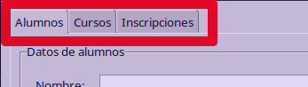

### Estudiantes
#### 1. Registrar un estudiante
  1. En los campos disponibles, ingresa nombre y matricula del estudiante.
  2. Haz clic en **Crear**.
  3. El sistema confirmara que el estudiante fue creado.
       

  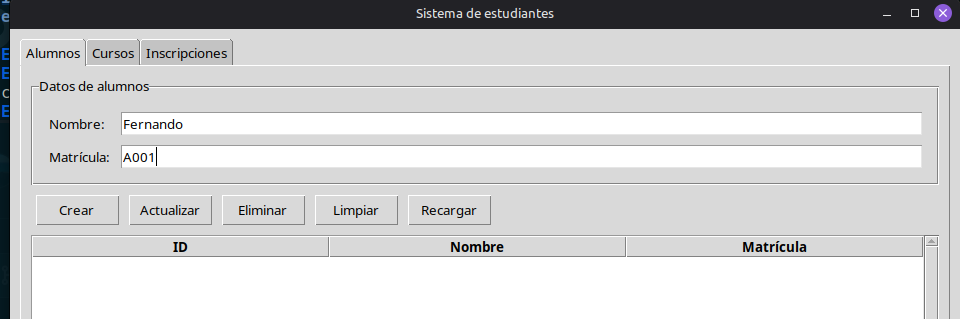

     
#### 2. Actualizar datos un estudiante
  1. Haz clic en un registro disponible para seleccionarlo.
  2. Se rellenaran los campos con la información del estudiante selecionado.
  3. En ese instante, podrás modificar algún valor como el nombre y/o la matricula.
  4. Haz clic en **Actualizar**
  5. El sistema confirmara que el estudiante fue actualizado.

  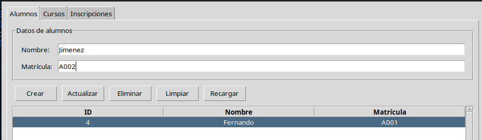

  
#### 3. Eliminar un estudiante
  1. Haz clic en un registro.
  2. Se rellenaran los campos de nombre y matricula con la información del estudiante seleccionado
  3. Haz clic en **Eliminar**
  4. El sistema confirmara que el estudiante seleccionado fue eliminado.

  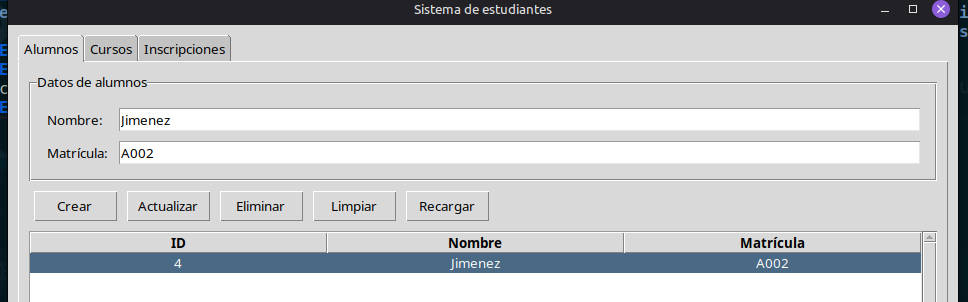

### Cursos
#### Registrar un curso
  1. En los campos disponibles, ingresa nombre del curso y sus creditos.
  2. Haz clic en **Crear**.
  3. El sistema confirmara que el curso fue creado.

  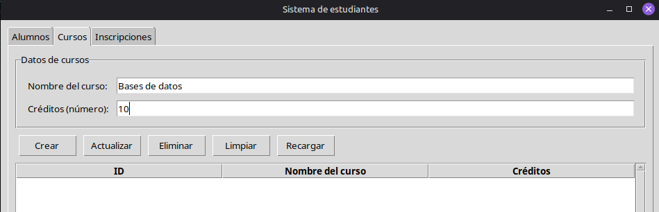

#### Actualizar datos de un curso
  1. Haz clic en un registro.
  2. Se rellenaran los campos de nombre y créditos con la información del curso seleccionado
  3. En ese instante, podrás modificar algún valor como el nombre y/o los creditos.
  4. Haz clic en **Actualizar**
  5. El sistema confirmara que el curso fue actualizado.

  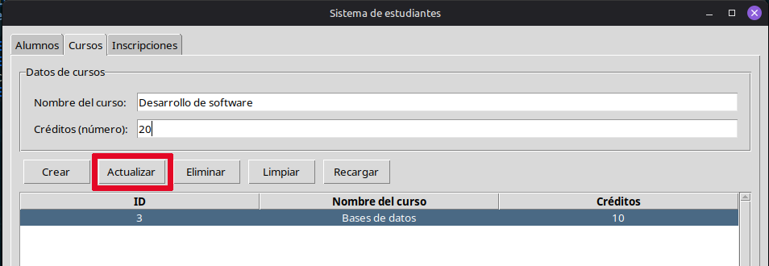

#### Eliminar un curso
  1. Haz clic en un registro.
  2. Se rellenaran los campos de nombre y creditos con la información del curso seleccionado.
  3. Haz clic en **Eliminar**.
  4. El sistema confirmara que el curso seleccionado fue eliminado.

  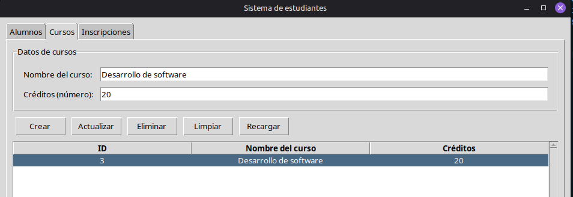

### Inscripciones
#### Registrar una inscripcion
  1. Cuando selecciones los campos de alumno y curso, se listaran los alumnos y cursos disponibles.
  2. Seleccionas el alumno y su curso al que quieras inscribirlo.
  3. Haz clic en **Inscribir**
  4. El sistema confirmara que la inscripción fue creada

  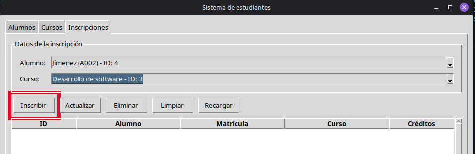

#### Actualizar datos una inscripcion
  1. Seleccionas algún registro que tengas ya guardado.
  2. Se rellenaran los campos de alumno y curso
  3. En ese instante podrás elegir otros cursos y de igual manera otros estudiantes
  4. Haz clic en **Actualizar**
  5. El sistema confirmara que la inscripción fue actualizada

  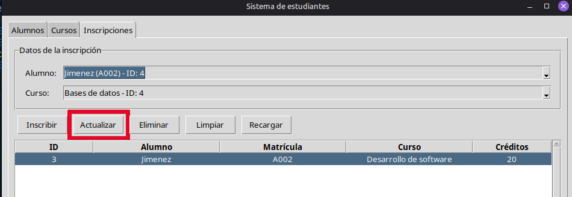

#### Eliminar una inscripcion
  1. Seleccionas algún registro que tengas ya guardado.
  2. Se rellenaran los campos de alumno y curso
  4. Haz clic en **Eliminar**
  5. El sistema confirmara que la inscripción fue eliminada

  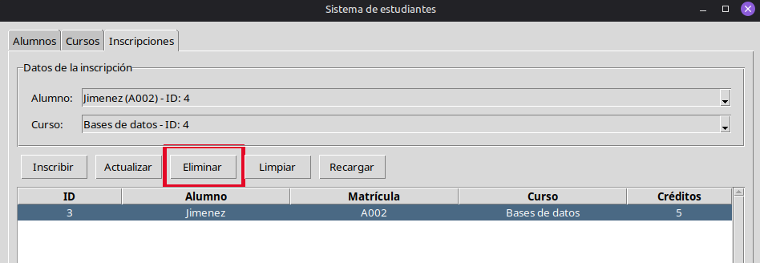

#### Botones para limpiar campos y recargar
- Si quieres limpiar los campos de texto, has clic en el boton llamado **Limpiar**.

  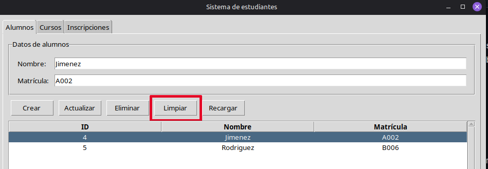

- Si quieres recargar todo el sistema, haz clic en **Recargar**.

  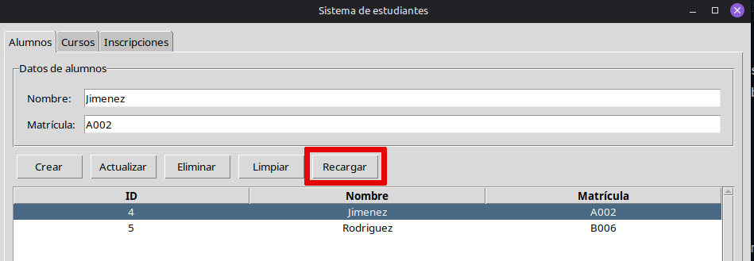

## Glosario
 - **Base de datos (SQLite):** Archivo donde se guarda toda la información del sistema.
 - **Registro:** Conjunto de datos almacenados, por ejemplo, un estudiante, un curso y/o una inscripcion.
 - **ID:** Numero único que identifica a cada estudiante, curso e inscripcion.
 - **Ejecutable (.exe):** Archivo que permite abrir el sistema sin necesidad de usar codigo.
